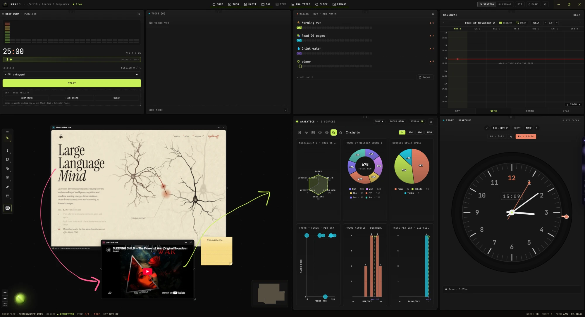
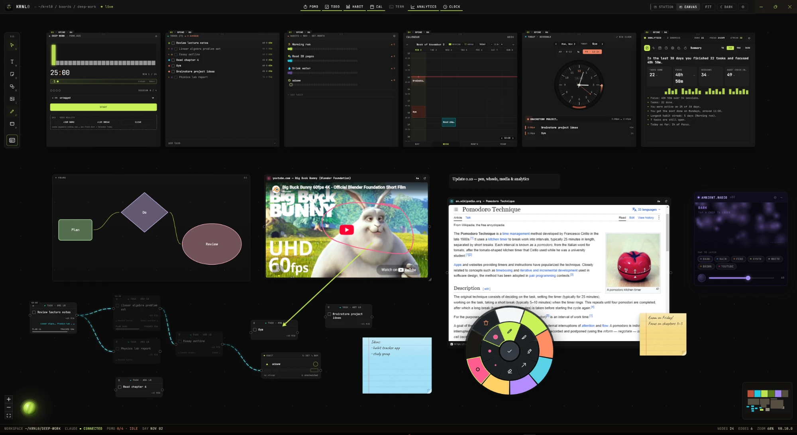

# krnl0 v0.10.0

The biggest update yet: a new look, an analytics window, task tags, pen and brainstorming tools, and drop-anything media on the canvas.

## New

**New logo and app icon.** The "Lit Core" voxel cube is now the app icon, the top-bar mark and the README logo.

**Analytics window.** Analytics is now a fixed window like Pomo, Todo, Habit, Calendar and Clock. In Station mode it has its own panel beside the terminal; in Canvas mode it sits in the window row.
- Eight full-window pages switched by icons: Summary, Activity, Year, Hours, Plan vs actual, Time by tag, Insights, Habits.
- Summary is written in plain language: what you did, how it compares to the period before, and when you work best.
- Nothing scrolls. Content splits into pages instead.

**Task tags.** Every task gets a tag automatically: Code, Study, Writing, Reading, Meetings, Admin, Planning, Health, Chores, Social or Creative.
- Click a tag to change it, or type a new name to make your own. Tags you pick teach the auto-tagger.
- Finished tasks move to a **Done** list, then to an **Archive** grouped by day. Nothing is deleted.
- Analytics shows where your time went, by tag.

**Habits & Routines.** Habits now double as recurring events.
- When you add one, or drop it on the Calendar, choose how it repeats: every day, weekdays or picked days, plus a time and a length.
- Scheduled habits show a repeat mark on the Calendar.

**Pen tool** (`P`). Draw on the canvas with pen, marker, highlighter, arrow or eraser, in 8 colours and 3 sizes.
- Right-click while drawing opens the tool wheel.
- Middle-drag pans while the pen is on.
- Strokes are objects: click or box-select them, drag to move, Delete to remove. They draw above everything.
- Drawings are saved with your board, and Ctrl+Z undoes them.

**Canvas wheel.** Right-click empty canvas for a radial menu: Task, Habit, Note, Sticky, Shapes, Media, Frame, Pen.

**Sticky notes and shapes** (`S`, `R`).
- Paper sticky notes with handwriting, ruled lines and a red margin.
- Rectangles, ellipses and diamonds, with a style bar to switch shape and colour.

**Drop or paste anything.**
- Drag or paste video, audio, PDFs, YouTube, Vimeo or SoundCloud links, websites, or any file onto the canvas.
- Videos stream instantly and you can seek. PDFs turn pages. Audio gets its own player.
- Links can switch to plain text.

**Calendar and Clock.**
- **Calendar:**
  - Year view.
  - Readable parallel tasks, with "+N" for overflow.
  - Pomo sessions shown as background highlights.
  - Right-click menus for tasks and sessions.
  - Task time is now optional (untimed tasks fade out).
  - A redesigned task popup.
  - Right-click a task anywhere and choose **Show on calendar** to jump to it.
- **Clock:**
  - Big Clock mode.
  - A bigger dial.
  - Task arcs that are easy to right-click.

**Pomo.** Simpler icon controls: Stop, Break, and Pause / Resume / End break. Choose in Pomo settings whether a stopped session still counts, instead of having a separate Reset button.

**Movable dock.** Drag the toolbar to the top, middle or bottom of the left edge, or to the bottom centre. Every button shows its shortcut.

**Easier connections.** Drop a connection anywhere on a node, not just on its dot.

## Fixed
- Light and dark mode are always available, in the top bar and in Settings. Before, the gear button sat where the theme button used to be, and it opened Factory reset.
- Mother windows no longer flash when you click inside them.
- Analytics text is sharp at any zoom, and cards no longer blur when you hover them.
- In Canvas mode, nodes never hide behind the window row, and switching between Station and Canvas keeps the view on the same spot.
- Drags no longer get stuck when you release over a YouTube or website card.
- YouTube links copied from a Mix playlist now play.
- Dropping a task onto another calendar task puts them side by side.
- Dropdown lists are readable in dark mode.
- Month cells stay readable.
- The status bar shows the real version.

## CLI
Every new feature has a `krnl` command:
- `analytics open | close | toggle | summary`
- `pomo segments | delete-segment`
- `clock dial`
- `cal view`
- `draw list | delete | clear`
- `media add | list`
- `text add --sticky | --shape`
- `todo tag`, `todo tags list | add | remove`, `todo archive`, `todo clear-archive`
- `analytics show --view tags`
- `pomo config --count-stopped on | off`

## Install (Windows)
Download **KRNL0 Setup 0.10.0.exe** below and run it.

Windows may warn about an unrecognised app because the installer isn't code-signed yet. Choose **More info → Run anyway**.
