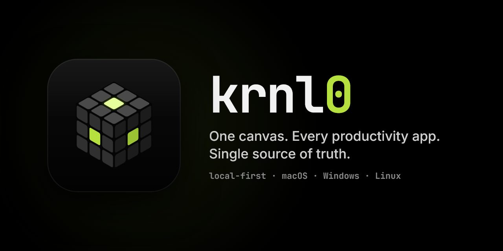

# krnl0 v0.11.2

Small fixes to adding plans and to the Calendar.

## Fixed

- **Setting a time while adding a plan.** Picking an hour in the time picker closed the plan card, so you couldn't pick the minutes. Now the card stays open while you pick the hour and the minutes.

## Changed

- **One + on the Calendar.** The **+** in the Calendar's header adds a plan or a repeating event: switch its card to **Repeats** for a class or a shift. The separate Repeating button is gone.
- **A calmer time column.** The Calendar writes each hour once; the lines between hours show only the minutes, small (`:30`).
- **No more mark on the clock's rim** for when KRNL0 was opened or closed.

## Updating

KRNL0 0.11.1 updates itself: you'll see *"KRNL0 0.11.2 is ready — Restart"*. If yours says *"Couldn't check for updates"* (the original 0.10.1 and 0.11.0), download **KRNL0-Setup-0.11.2.exe** below and run it once. It keeps your board. Windows may warn about an unrecognised app because the installer isn't code-signed yet: choose **More info → Run anyway**.
