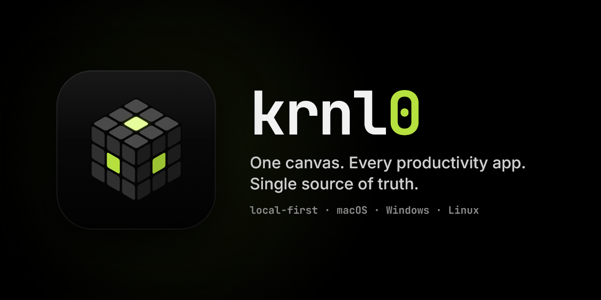

# krnl0 v0.16.0

Your Google and iCloud calendars beside your plans, your plans on your phone, and Today on one phone screen.

## New

**Your other calendars, right here.**
- Sign in with Google or Apple (iCloud) once, in the Calendar's menu under **Add your calendars**, or in Settings. Their events sit on your Calendar next to your plans, outlined so you can tell them apart.
- KRNL0 only reads those calendars. It never changes or deletes an event in them.
- For iCloud, Apple asks for an app-specific password; KRNL0 shows you where to make one.

**Your plans, on your phone.**
- Leave **Put KRNL0 on your Google too** (or **on your iPhone too**) switched on when you sign in. Your events and planned tasks go to a calendar called **KRNL0** there.
- Move or delete one on your phone and KRNL0 follows.
- After signing in with Google, the browser shows a KRNL0 page telling you it worked.

**Today fits one screen.**
- On your phone, Today shows the date, your day on the clock and one timer, with no scrolling.
- Your todos have their own tab; Insights and Canvas are under **More**.

## Also new

- Add a calendar link (an address ending in .ics), or bring in an .ics file. Save your plans as an .ics file for any other calendar app.
- A new tour, **Your other calendars**, in Help › Tutorials.
- Commands: `krnl cal link`, `krnl cal links`, `krnl cal sync`, `krnl cal import`, `krnl cal export`, `krnl cal accounts`, `krnl cal signout`.
- The top bar stays still when it says Saved or Synced, and folds neatly when the window is narrow. Its menus always open whole.
- The KRNL0 window keeps a smallest size, so nothing gets squashed.
- What's new fits a phone screen, with Done always in reach.
- What KRNL0 does with your calendars, in plain words: [krnl0.com/privacy.html](https://krnl0.com/privacy.html)
